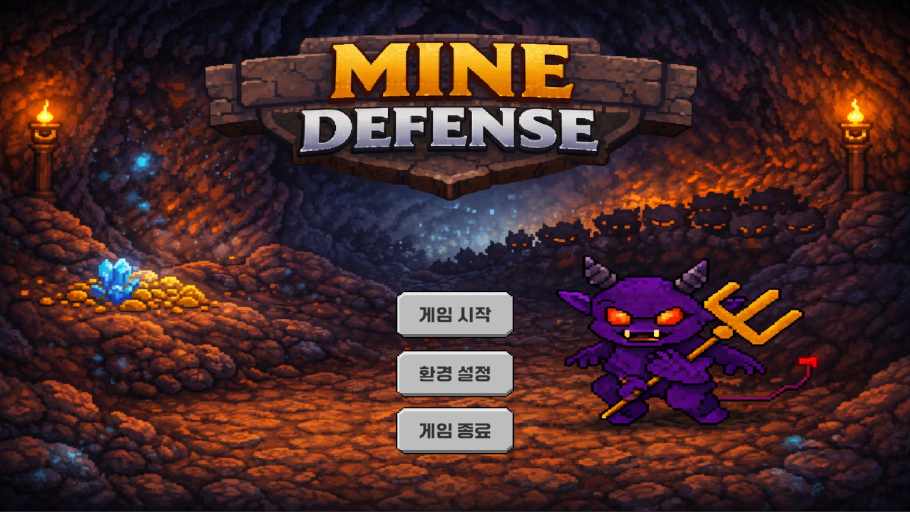
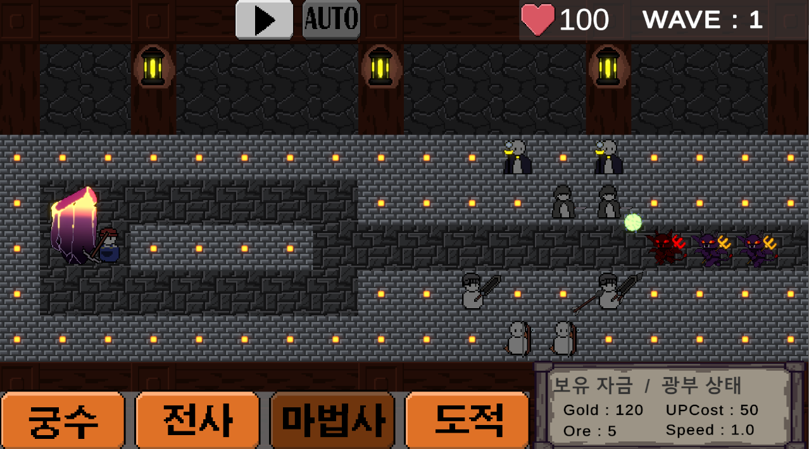
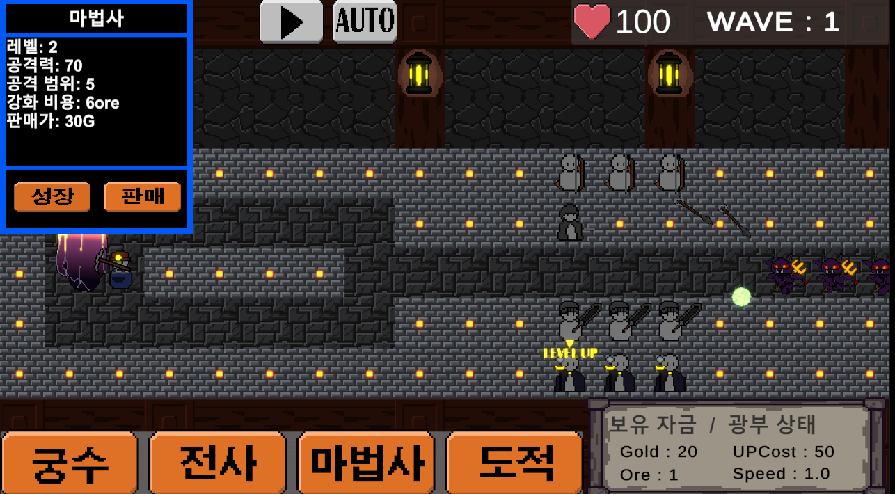
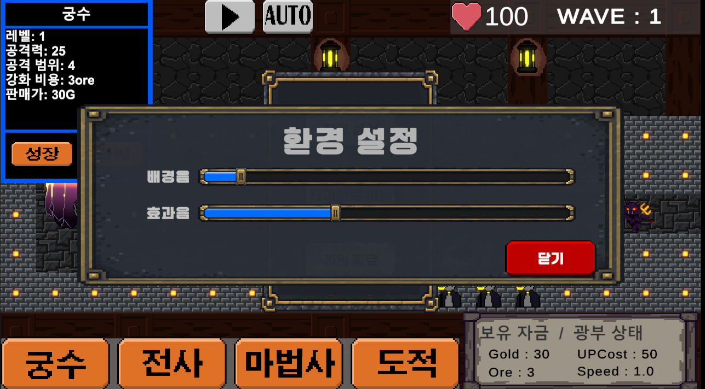

# MineDefense
몬스터로부터 광부를 지키기 위해 타워를 배치하고 강화하는 Unity 2D 타워 디펜스 게임입니다.

전투로 획득한 골드로 타워를 건설하고 광부를 강화하며 광부가 생산하는 광석으로 타워를 강화해 이어지는 웨이브에 대응합니다.

## 프로젝트 개요

| 항목 | 내용 |
|---|---|
| 프로젝트명 | MineDefense |
| 장르 | 2D 타워 디펜스 |
| 개발 인원 | 1인 개발 |
| 개발 목표 | Unity 기반 타워 게임의 시작부터 종료까지 전체 흐름의 완성 |
| 실행 플랫폼 | Windows |

## 기술 스택

| 분류 | 사용 기술 |
|---|---|
| Engine | Unity 6 |
| Language | C# |
| IDE | Visual Studio 2022 |
| Version Control | Git, GitHub |

## 플레이 영상

▶ 이미지를 클릭하면 플레이 영상으로 이동합니다.

## 플레이 화면

### 타이틀

### 인게임 전투
서로 다른 공격 방식을 가진 타워를 배치하여 몬스터로부터 광부를 보호합니다.

### 타워 정보 및 강화
타워의 능력치와 강화 비용을 확인하고, 광석을 소비하여 강화할 수 있습니다.

| 강화 전 | 강화 후 |
|---|---|
|  |  |

### 음량 설정
배경음악과 효과음의 음량을 각각 조절할 수 있습니다.

## 주요 기능

### 타워 건설 및 강화
- 전사, 궁수, 도적, 마법사 타워를 지정된 건설 위치에 배치할 수 있습니다.
- 전사는 근접 범위 공격, 궁수는 단일 투사체 공격, 도적은 근접 단일 공격, 마법사는 범위 피해를 주는 투사체 공격을 사용합니다.
- 광석을 소비하여 타워를 강화하고 배치한 타워를 판매할 수 있습니다.

### 광부 보호 및 자원 관리
- 몬스터로부터 광부를 보호하며 방어를 이어갑니다.
- 광부가 생산하는 광석은 타워 강화에 사용합니다.
- 몬스터 처치로 획득한 골드는 타워 건설과 광부 강화에 사용합니다.
- 광부 강화 시 채굴 간격이 줄어들고 체력이 회복됩니다. 최대 강화 이후에는 골드를 소비하여 체력을 회복할 수 있습니다.

### 웨이브 진행
- 웨이브에 따라 몬스터가 등장하며 진행할수록 난이도가 상승합니다.
- 자원을 활용해 타워와 광부를 강화하며 다음 웨이브에 대비합니다.
- 광부의 체력이 모두 소진되면 게임이 종료되고 결과 화면이 표시됩니다.

### 게임 정보 UI
- 현재 골드, 광석, 웨이브를 화면에서 확인할 수 있습니다.
- 타워와 광부를 클릭하여 정보를 확인하고 강화할 수 있습니다.

### 사운드 및 음량 설정
- 타이틀과 인게임에 서로 다른 배경음악을 적용했습니다.
- 타워별 공격, 피격, 적 사망, 버튼 클릭, 강화 성공에 효과음을 적용했습니다.
- 배경음악과 효과음의 음량을 각각 조절할 수 있으며, 설정한 값은 저장됩니다.

### 일시정지 메뉴
- 인게임에서 ESC 키로 메뉴를 열면 게임이 일시정지됩니다.
- 메뉴에서 음량 설정, 타이틀 이동, 게임 종료를 선택할 수 있습니다.

## 조작 방법

| 입력 | 동작 |
|---|---|
| 타워 종류 버튼 클릭 -> 건설 위치 클릭 | 선택한 타워 건설 |
| 배치된 타워 클릭 | 타워 정보창 표시 |
| 타워 정보창의 성장 버튼 클릭 | 광석을 소비하여 타워 강화 |
| 타워 정보창의 판매 버튼 클릭 | 타워 판매 |
| 광부 클릭 -> 성장 버튼 클릭 | 골드를 소비하여 광부 강화 |
| 웨이브 시작 버튼(▶) 클릭 | 웨이브 시작 |
| AUTO 버튼 클릭 | 웨이브 자동 진행 켜기 및 끄기 |
| 빈 공간 클릭 | 열린 정보창과 건설 선택 UI 닫기 |
| 인게임 내에서 ESC | 일시정지 메뉴 열기 및 닫기 |
| 인게임 내에서 환경설정이 열린 상태에서 ESC | 환경설정 닫기 |
| 음량 슬라이더 조작 | 배경음악과 효과음의 음량 조절 |

※ 게임 오버 화면과 타이틀 화면에서는 ESC로 메뉴가 열리지 않습니다.

## 프로젝트 구조
게임 로직은 'Assets/Script' 에서 아래에 기능별로 나누어 관리합니다.

| 경로 | 구성 |
|---|---|
| `Assets/Script/Audio` | 배경음악, 효과음 재생 / 음량 설정 및 저장 |
| `Assets/Script/Build` | 타워 건설 슬롯 생성 |
| `Assets/Script/Class` | 공격 인터페이스, 타워별 공격, 투사체 및 공격 애니메이션 이벤트 |
| `Assets/Script/Enemy` | 적 생성, 이동, 피해 및 사망 처리 |
| `Assets/Script/Manager` | 게임 종료, 웨이브, 자원, 건설 및 타워 선택 관리 |
| `Assets/Script/Miner` | 광부의 체력, 광석 생산 및 강화 |
| `Assets/Script/Tower` | 타워의 대상 탐색, 공격, 강화 / 빈 공간 클릭 처리 |
| `Assets/Script/UI` | 건설, 정보 UI / 일시정지 메뉴 및 씬 이동 |
| `Docs/Images` | README에 사용하는 게임 스크린샷 |

## 주요 스크립트 역할

### 타워 건설 및 전투

| 스크립트 | 역할 |
|---|---|
| `BuildSlotGenerator.cs` | 타워를 배치할 건설 슬롯 생성 |
| `BuildManager.cs` | 건설 모드와 건설할 타워 선택 관리 |
| `BuildSlot.cs` | 슬롯의 타워 배치 상태 관리, 건설 비용 차감 및 타워 생성/선택/제거 |
| `Tower.cs` | 공격 대상 탐색, 공격 주기에 따른 공격 실행 요청 및 타워 강화 |
| `IAttack.cs` | 타워별 공격 실행과 공격력 계산을 위한 공통 함수 정의 |
| `WarriorAttack.cs` | 전사의 근접 범위 공격 |
| `AcherAttack.cs` | 궁수의 단일 대상 공격을 위한 화살 생성 |
| `AssasinAttack.cs` | 도적의 근접 단일 대상 공격 |
| `MagicainAttack.cs` | 마법사의 범위 공격을 위한 마법 투사체 생성 |
| `ShotAttack.cs` | 화살의 대상 추적 및 충돌한 적에게 피해 적용 |
| `ShotRange.cs` | 마법 투사체의 대상 추적 및 충돌 지점 주변의 적에게 범위 피해 적용|

### 게임 진행 및 자원

| 스크립트 | 역할 |
|---|---|
| `WaveManager.cs` | 웨이브 시작/종료, 수동/자동 진행 및 웨이브별 적의 수, 적 생성 간격, 적 능력치 증가 관리 |
| `EnemySpawner.cs` | 웨이브 설정에 따른 적 생성|
| `EnemyMovement.cs` | 적의 이동 처리 |
| `Enemy.cs` | 적의 체력 관리, 피해/사망 처리 및 처치 보상 지급 |
| `Miner.cs` | 광석 생산, 광부의 체력 관리 및 강화/회복/사망 처리 |
| `GoldManager.cs` | 보유 골드 관리 |
| `OreManager.cs` | 보유 광석 관리|
| `GameManager.cs` | 게임 오버 시 결과 화면 표시 요청 및 게임 시간 정지|

### UI 및 사운드

| 스크립트 | 역할 |
|---|---|
| `BuildUI.cs` | 타워 건설 선택 UI 열기 및 닫기 |
| `TowerSelectButton.cs` | 버튼 입력을 통한 건설할 타워 선택 및 선택 상태 표시 |
| `TowerInfoUI.cs | 선택한 타워의 정보 표시 및 강화/판매 버튼 처리 |
| `MinerUpgradeUI.cs` | 광부 정보 표시 및 강화 버튼 처리|
| `TowerSelectManager.cs` | 배치된 타워의 선택 상태와 선택 표시 관리 |
| `ClickOutSide.cs` | 빈 공간 클릭 시 열린 UI 닫기 및 선택 해제 |
| `UiManager.cs` | 골드/광석/웨이브 정보 표시 및 게임 오버 화면 열기 |
| `GameMenuUI.cs` | ESC 메뉴와 일시정지/재개 처리, 게임 오버 중 메뉴 열기 제한|
| `LoadScene.cs` | 게임 씬/타이틀 씬 전환 및 게임 종료 |
| `AuidoManager.cs` | 배경음악/효과음 재생, AudioMixer를 통한 음량 조절 및 설정값 저장 |
| `AudioSettingController.cs` | 음량 설정 창 열기/닫기 및 슬라이더 입력에 따른 음량 변경 요청 |

## 핵심 구현

### 1. 인터페이스를 활용한 타워별 공격 분리

- `Tower`는 공격 대상 탐색, 공격 주기 및 타워 레벨을 관리합니다.
- `IAttack`에는 공격 실행을 위한 `Excute()`와 공격력 계산을 위한 `GerDamage()`를 정의했습니다.
- 각 직업의 공격 스크립트는 `IAttack`을 구현하여 근접 단일 공격, 근접 범위 공격, 투사체 공격을 수행합니다.
- `Tower`는 직업별 클래스를 직접 구분하지 않고 `IAttack.Execute()`에 대상, 공격 범위, 레벨을 전달합니다.

이 구조로 대상 ㅌ탐색과 공격 주기를 공통으로 사용하면서 직업별 공격 방식은 각 공격 스크립트에서 관리할 수 있도록 했습니다.

### 2. 애니메이션 이벤트를 활용한 공격 시점 관리

공격 명령을 받은 시점과 실제 피해를 적용하는 시점을 분리했습니다.

- 각 공격 스크립트의 `Execute()`에서 공격에 필요한 정보를 저장하고 애니메이션을 시작합니다.
- 공격 애니메이션의 적중 또는 발사 프레임에 이벤트를 배치했습니다.
- 자식 오브젝트의 애니메이션 이벤트 전달 스크립트가 부모의 공격 스크립트에 있는 `Dealing()`을 호출합니다.
- 전사와 도적은 이 시점에서 직접 피해를 적용하고 궁수와 마법사는 투사체를 생성합니다.
- 생성된 투사체는 별도의 스크립트에서 대상을 추적하고 충돌 시 피해를 적용합니다.

이를 통해 근접 공격의 피해 판정과 원거리 공격의 투사체 생성 시점을 공격 동작에 맞췄습니다.

### 3. 코루틴을 활용한 웨이브 진행

`WaveManager`에서 적 생성부터 웨이브 종료, 다음 웨이브 대기까지 관리합니다.

- 웨이브 시작 시 적 수, 생성 간격 및 능력치 증가 값을 설정합니다.
- 코루틴에서 생성 간격만큼 대기하며 `EnemySpawner`를 통해 적을 순차적으로 생성합니다.
- 웨이브에 속한 적이 제거되면 남은 적의 수를 줄이고, 모두 제거되면 해당 웨이브를 종료합니다.
- 웨이브 종료 후에는 일정 시간 대기한 뒤 자동 진행 여부에 따라 다음 웨이브를 시작하거나 사용자 입력을 기다립니다.
- 수동 시작과 자동 진행은 공통 시작 함수를 사용하며, 시작 대기 상태에서만 시작 요청을 받습니다.

적을 생성하는 역할과 웨이브 진행을 판단하는 역할을 나누고 수동/자동 진행에 동일한 웨이브 규칙을 적용했습니다.

### 4. AudioMixer를 활용한 음량 설정

`AudioManager`가 사운드 재생과 음량 설정을 담당하고 `AudioSettingsScontroller`가 설정 UI의 입력을 전달하도록 분리했습니다.

- 배경음악과 효과음의 AudioSource를 AudioMixer의 BGM/SFX 그룹에 각각 연결했습니다.
- 씬에 따라 타이틀과 인게임 배경음악을 전환합니다.
- 효과음은 `SfxType`으로 구분하여 버튼 클릭, 공격, 피격, 사망, 강화 성공 시점에 재생합니다.
- 슬라이더의 값을 AudioMixer에서 사용하는 데시벨 값으로 변환하여 그룹 음량에 반영합니다.
- 음량 설정은 `PlayerPrefs`에 저장하고 다음 실행 시 불러옵니다.
- 설정 창을 열 때는 `SetValueWihoutNotify()`로 현재 음량을 표시하여 슬라이더 초기화 과정에서 음량 변경 이벤트가 다시 호출되지 않도록 했습니다.

이후 AudioSource가 추가되더라도 같은 믹서 그룹에 연결하면 기존 BGM/SFX 음량 설정을 함께 적용받을 수 있습니다.

## 개발 중 해결한 문제

### 1. 타워 클릭이 간혈적으로 동작하지 않는 문제

**문제 현상**

웨이브 진행 중 일부 타워를 클릭해도 정보창이 열리지 않았습니다.
같은 종류의 타워라도 어떤 위치에서는 선택되고, 다른 위치에서는 선택되지 않았습니다.

이 문제는 수동 진행과 AUTO 모드 모두에서 발생했습니다.
수동으로 다음 웨이브를 시작하면 다시 선택되는 경우가 있었지만 AUTO 모드에서는 선택되지 않는 상태가 계속 유지되기도 했습니다.

**원인 추적**

처음에는 타워와 겹쳐 있는 UI가 클릭을 막는다고 생각했습니다.
그러나 해당 UI의 Raycast Target을 비활성화해도 문제가 해결되지 않았습니다.

다음으로 `Tower.OnMouseDown()`의 시작 부분에 로그를 추가했습니다.
문제가 발생한 타워에서는 로그가 출력되지 않았습니다.
이를 통해 정보창을 여는 코드가 실행되기 전에 클릭 전달에서부터 문제가 생긴다는 것을 확인했습니다.

클릭 위치에 어떤 오브젝트가 있는지 알아보기 위해
`Physics2D.OverlaPointAll()`로 해당 위치의 Collider2D를 출력했습니다.
그 결과 건설 슬롯, 타워, 배경의 Collider2d가 겹쳐 있음을 확인했습니다.

타워는 건설 슬롯의 자식으로 생성되며 설치 후에도 슬롯은 남아 있었습니다.
타워와 슬롯 모두  Collider2D와 `OnMouseDown()`을 가지고 있었으므로 타워를 클릭한 위치에서 슬롯의 클릭 함수가 호출될 수 있었습니다.

그러나 당시 슬롯의 클릭 함수는 건설과 삭제만 처리했습니다.
건설/삭제 모드가 아닌 일반 상태에서 슬롯이 클릭됐을 때 해당 위치에 설치된 타워를 선택하는 처리가 없었습니다.
따라서 슬롯이 클릭을 받으면 아무 동작도 하지 않아 타워 정보창이 열리지 않았습니다.

**해결 방법**
- `BuildSlot.OnMouseDown()`에 일반 상태인 `BuildMode.None`의 처리를 추가했습니다.
- `SelectCurrentTower()`에서 슬롯이 보관하고 있는 `currentTower`를 확인하도록 했습니다.
- 설치된 타워가 있으면 해당 타워의 정보창을 열고 선택 표시를 갱신했습니다.

수정 후에는 타워가 클릭되면 기존처럼 타워의 클릭 함수가 정보창을 열고 슬롯이 클릭되면 슬롯이 자신에게 설치된 타워를 찾아 정보창을 열게 됐습니다.

기존에는 증상을 완화하기 위해 수동 웨이브 시작 시 타워의 Collider2D를 껐다가 다음 프레임에 다시 켜는 코드를 사용하고 있었습니다.
슬롯에서도 타워를 선택할 수 있도록 수정한 뒤에는 이 임시 코드를 제거했습니다.

**결과**

수동/AUTO 진행, 앞/뒷줄 타워 배치, 웨이브 진행 중과 대기 중에 타워 선택을 반복 확인했습니다.
기존에 클릭되 않던 위치에서도 정보창이 정상적으로 열렸으며 확인한 상황에서는 문제가 재발하지 않았습니다.

**배운점**

클릭 함수의 시작 부분에 로그를 추가하면 함수가 호출되지 않는 문제인지 호출된 뒤의 처리 문제인지 구분할 수 있었습니다.

또한 타워를 클릭했다고 생각해도 같은 위치에 겹쳐 있는 건설 슬롯이 클릭을 받을 수 있다는 점을 확인했습니다.
클릭 문제를 조사할 때는 타워의 코드뿐 아니라 클릭 위치에 있는 다른 오브젝트와 그 오브젝트의 클릭 처리도 함께 확인해야 한다는 점을 배웠습니다.

### 2. 여러 UI를 닫을 때 효과음이 한 번만 재생되도록 처리

**구현 과정에서 고려한 문제**

빈 공간을 클릭하면 타워 정보창, 광부 정보창, 건설 선택 UI를 닫도록 구현돼 있었습니다.
여기에 효과음을 추가하면서 실제로 열린 UI를 닫는 경우에만 소리가 나도록 해야 했습니다.

빈 공간의 클릭 함수에 효과음 재생을 그대로 추가하면 열린 UI가 없어도 클릭할 때마다 소리가 나게 됩니다.
반대로 각 UI의 닫기 함수에 효과음을 추가하면 여러 UI를 함께 닫을 때 소리가 겹쳐 재생될 수 있었습니다.

**처리 방법**

`ClickOutSide`에서 UI를 닫기 전에 각 패널이 열려 있는지 확인했습니다.
하나라도 열려 있었다면 `wasAnyUIOpen`에 true값을 저장하고 기존 UI 닫기와 선택 해제 처리를 마친 뒤 효과음을 한 번 재생하도록 했습니다.

이 과정에서 함께 호출되는 `BuildUI.CloseBuildMenu()`의 효과음 재생 코드는 제거하여 같은 클릭으로 소리가 중복 재생되지 않도록 했습니다.

**결과**

열린 UI가 없는 상태에서 빈 공간을 클릭하면 소리가 나오지 않고 하나 이상의 UI를 닫는 경우에는 효과음이 한 번만 재생되도록 했습니다.

**배운 점**

여러 UI가 같은 클릭에 반응하는 경우 각 UI에 효과음을 따로 추가하면 재생이 중복될 수 있다는 점을 알게 됐습니다.
이번에는 빈 공간 클릭을 처리하는 곳에서 UI 상태를 확인하고 효과음을 한 번만 재생하도록 하여 재생 조건을 명확하게 정리했습니다.

### 3. 실제로 강화에 성공했을 때만 효과음 재생

**구현 과정에서 고려한 문제**

타워와 광부의 강화에는 자원이 필요하므로 강화 버튼을 눌러도 보유 자원이 부족하면 강화되지 않습니다.

따라서 버튼을 클릭할 때마다 성공 효과음을 재생하면 강화 성공 여부에 상관없이 소리가 재생되어 강화가 되지 않아도 강화에 성공했다 오해할 수 있었습니다.

**처리 방법**

강화 버튼을 처리하는 UI에서는 강화 함수를 호출하고 정보를 갱신하도록 했습니다.
성공 효과음은 UI에서 무조건 재생하지 않고 자원 확인과 실제 상태 변경을 수행하는 함수에서 재생하도록 옮겼습니다.

- 타워는 `Tower.Upgrade()`에서 광석이 충분한지 확인하고 비용 차감과 레벨 증가를 마친 뒤 효과음을 재생했습니다.
- 광부는 `Miner.UpgradeMiner()`에서 골드가 충분한지 확인하고 비용을 지불하여 강화 또는 체력 회복을 수행한 경우에 효과음을 재생하도록 했습니다.
- 자원이 부족한 경우에는 성공 효과음이 재생되지 않도록 했습니다.

**결과**

강화 버튼을 눌렀다는 미유만으로 성공 효과음이 나오지 않고 실제로 자원을 소비하여 강화하거나 회복한 경우에만 재생되도록 했습니다.

**배운 점**

버튼 입력은 행동을 요청한 것이고 자원 확인을 거쳐 실제 상태가 변경됐는지 별도로 판단해야 한다는 점을 배웠습니다.
성공을 알리는 소리나 연출은 실제 처리가 완료되는 시점에 연결해야 사용자에게 정확한 결과를 전달할 수 있었습니다.

## 개발 회고

### 게임 전체 흐름을 완성한 경험

MineDefense는 처음으로 하나의 Unity 게임을 완성하는 것을 목표로 진행한 프로젝트입니다.
특정 기술이나 최적화에 집중하기보다 타이틀에서 게임을 시작하고 타워를 건설하여 웨이브를 진행한 뒤 게임 오버와 타이틀 복귀까지 이어지는 전체적인 흐름 구현에 집중했습니다.

프로젝트를 다시 정리하면서 배경음악과 효과음, 음량 설정, 일시정지 메뉴와 게임 종료 버튼을 추가했습니다.
이러한 부가 기능을 추가하면서 전투 기능만 구현했을 때보다 하나의 완성된 게임에 가까워졌다는 것을 느겼습니다.

### 앞으로 개선하고 싶은 부분

아래 항목은 현재 버전에 적용한 기능이 아니라 후속 작업에서 검토할 개선 방향입니다.

- **적과 투사체 오브젝트 풀링**
  
  현재는 필요할 때 생성하고 사용이 끝나면 제거하는 방식을 사용중입니다.
  웨이브가 진행되면서 생성/제거 횟수가 늘어나는 상황을 프로파일링하고 비용이 큰 경우 오브젝트를 반환받아 재사용하는 방식으로 개선하고 싶습니다.
  적용 전후의 프레임 시간과 메모리 할당을 비교하려 효과를 확인할 계획입니다.

- **값이 변경될 때만 UI 갱신**
  
  현재 골드/광석/웨이브 표시는 매 프레임 갱신합니다.
  초기 표시 이후에는 값이 변경됐을 때만 갱신하도록 바꾸어 같은 내용을 반복해서 표시하는 처리를 줄이고 싶습니다.
  
- **대상이 사라졌을 때의 투사체 처리**
  
  현재는 발사 전에 대상이 사라지면 투사체를 생성하지 않고 비행 중 대상이 사라지면 투사체도 제거합니다.
  공격 모션에 맞춰 발사를 유지하고, 대상을 잃으면 주변의 다른 적을 찾거나 마지막 목표 위치까지 이동한 뒤 소멸하도록 개선하는 방안을 검토하고 있습니다.

## 리소스 제작

| 구분 | 제작 방식|
|---|---|
| 그래픽 | 직접 제작한 이미지와 ChatGpt로 생성한 이미지 수정하여 사용|
| 배경음악 | Suno를 활용하여 타이틀과 인게임 BGM 생성|
| 효과음 | ChatGPT를 활용하여 제작한 효과음 사용|
